# Nöbetçi Memur

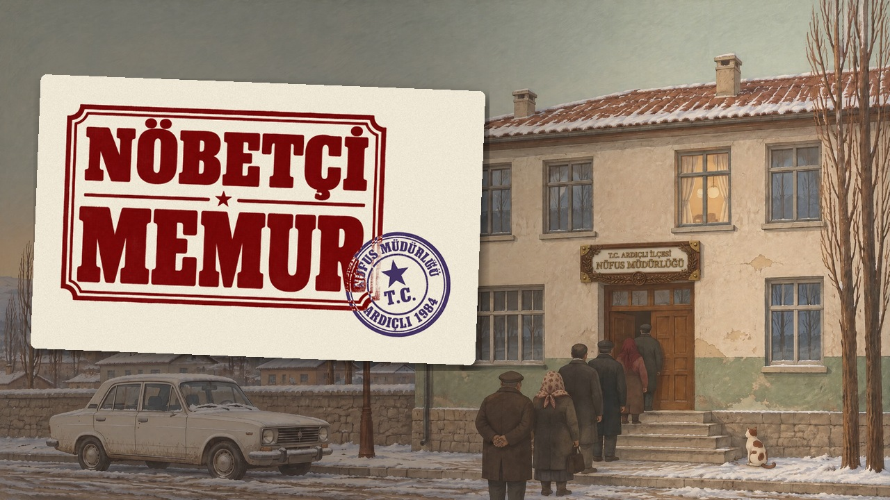

> **1984. Bir gişe, bir mühür, bitmeyen bir kuyruk.**

**[▶ Tarayıcıda oyna](https://xaena53.github.io/nobetci-memur/)** · **[⬇ Windows için indir](https://github.com/Xaena53/nobetci-memur/releases/latest)**

Tarayıcı sürümü kurulum istemez; bilgisayarda Chrome, Firefox, Edge ya da Safari ile açılır (ilk
açılışta ~80 MB yüklenir). Windows sürümünde zip'i açıp `NobetciMemur.exe`'yi çalıştırmanız yeter;
eski 32 bit bilgisayarlar için ayrı bir paket de vardır.


Ardıçlı İlçesi Nüfus Müdürlüğü'nün 2 numaralı gişesine yeni atanan memursunuz. Camın öbür
yanında kuyruk kapıya kadar uzuyor; herkesin elinde bir nüfus cüzdanı, bir ikametgâh ilmühaberi ve
çok önemli bir işi var. Sizin elinizde bir mühür, bir büyüteç ve müdürün her sabah değişen genelgesi.

Evrakı okur, **onaylar**, gerekçesiyle **geri çevirir** ya da **müdüre havale** edersiniz. Akşam
eve dönünce maaşı kira, kömür, yiyecek, ilaç ve okul masrafı arasında bölüştürürsünüz. Yedi iş
gününün sonunda başınıza gelen, gazetenin birinci sayfasında yazar.

Evrak kontrolü türünde, hüzünlü ve komik, tek kişilik bir hikâye oyunudur. Bir oynanış 45–60
dakika sürer. Godot 4.3 ile yazılmıştır; Türkçe, İngilizce ve Rusça oynanabilir.

| | |
|---|---|
| Motor | Godot 4.3 (GDScript), Compatibility çizici |
| Platform | Windows, Web (HTML5) |
| Çözünürlük | 1280 × 720 tasarım; her pencere boyutuna ölçeklenir |
| Dil | Türkçe, İngilizce, Rusça |
| Sürüm | 1.7.0 |

---

## İçindekiler

- [Nasıl oynanır](#nasıl-oynanır)
- [Bir haftanın hikâyesi](#bir-haftanın-hikâyesi)
- [Kurallar gün gün](#kurallar-gün-gün)
- [Geçim](#geçim)
- [Sonlar](#sonlar)
- [Kurulum ve çalıştırma](#kurulum-ve-çalıştırma)
- [Dışa aktarma ve yayın](#dışa-aktarma-ve-yayın)
- [Proje yapısı](#proje-yapısı)
- [İçerik eklemek](#i̇çerik-eklemek)
- [Testler](#testler)
- [Görsel ve ses üretim hattı](#görsel-ve-ses-üretim-hattı)
- [Emeği geçenler ve lisanslar](#emeği-geçenler-ve-lisanslar)

---

## Nasıl oynanır

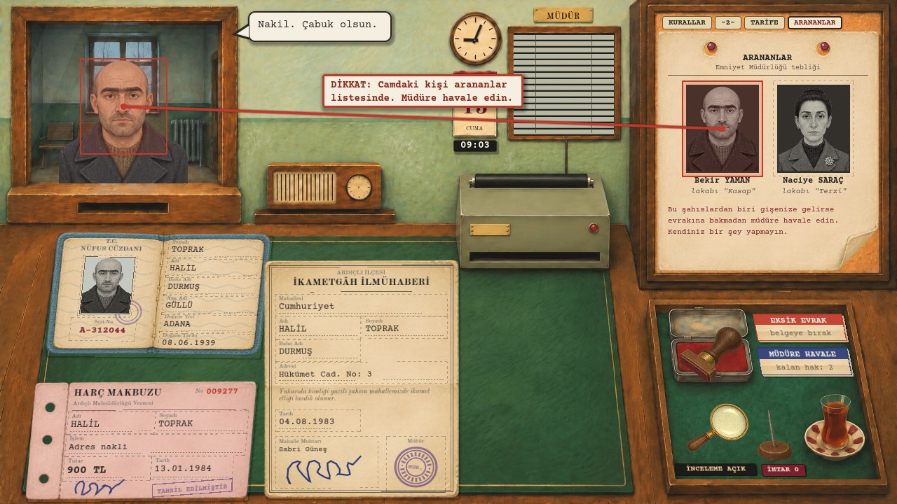

Her gün müdürün genelgesiyle başlar. Genelgeyi okuyup **Gişeyi Aç**'a basınca duvardaki saat
09:00'dan işlemeye başlar ve ilk vatandaş cama gelir. Belgeleri yarıktan masanıza kayar.

1. **Okuyun.** Belgeleri sürükleyin; çift tıklayınca elinize kalkıp büyürler.
2. **Karşılaştırın.** BOŞLUK tuşu ya da büyüteç inceleme modunu açar. İki bilgiye tıklayın: oyun
   aralarına bir çizgi çeker ve uyuşup uyuşmadıklarını söyler. Ad adla, tarih duvardaki takvimle,
   tutar tarifeyle, fotoğraf camdaki yüzle karşılaştırılır.
3. **Karar verin.** Sağdaki tepsiden bir aracı alıp belgenin üstüne bırakın:
   - **Onay mührü** (yeşil lastikli): evrak tamsa. Belgeye yeşil "ONAYLANMIŞTIR" basar.
   - **Ret mührü** (kırmızı lastikli): kusur varsa. Gerekçeyi sorar; doğru gerekçeyi seçmek gerekir.
     Belgeye kırmızı "REDDEDİLMİŞTİR" basar, altına gerekçeyi yazar.
   - **Müdüre havale pusulası:** sahtecilikten şüphelenirseniz. Günde iki hakkınız vardır.

Doğru karar prim kazandırır. Yanlış kararda masadaki teleks çalışır ve müdürün ihtarı satır satır
basılır. Günde üçüncü ihtardan itibaren maaşınız kesilir.

### Görev şekli

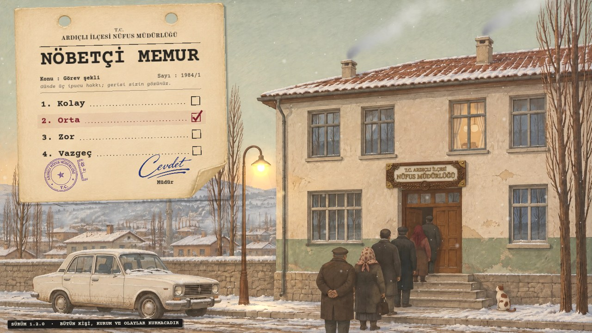

Yeni oyuna başlarken üç görev şeklinden biri seçilir; seçim kayıtla birlikte saklanır.

| Şekil | İnceleme modu | Saat | Sahtecilik |
|---|---|---|---|
| **Kolay** | Her karşılaştırmanın sonucu söylenir | Ağır işler | Göze batar |
| **Orta** | Günde üç ipucu hakkı; balona tıklayınca sonuç açılır | Olağan | Olağan |
| **Zor** | İpucu yok; çizgi çekilir, karar sizindir | Olağan | Bir kademe daha ince |

### Bilgi defteri ve sahte evrak

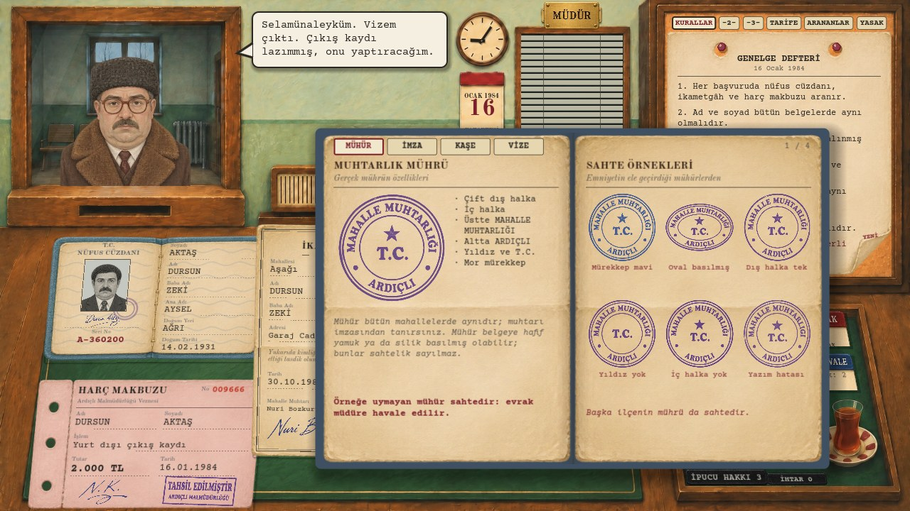

Dördüncü günden itibaren masada bir **bilgi defteri** durur; çift tıklayınca açılır. Dört yaprağı
vardır: muhtarlık mührü, muhtarların imza sirküleri, vezne ve konsolosluk kaşeleri, çalışma vizesi.
Her yaprakta gerçeğin özellikleri ve emniyetin ele geçirdiği sahte örnekler yan yana durur.

Evraktaki mühür, imza ya da kaşe defterdeki örneğe uymuyorsa evrak sahtedir: mürekkebin rengi
yanlıştır, mühür oval basılmıştır, yıldızı ya da iç halkası yoktur, yazısında bir harf eksiktir,
başka ilçenin mührüdür ya da imza o mahallenin muhtarına ait değildir. Sahte evrak geri çevrilmez,
**müdüre havale** edilir.

### Çalışma vizesi

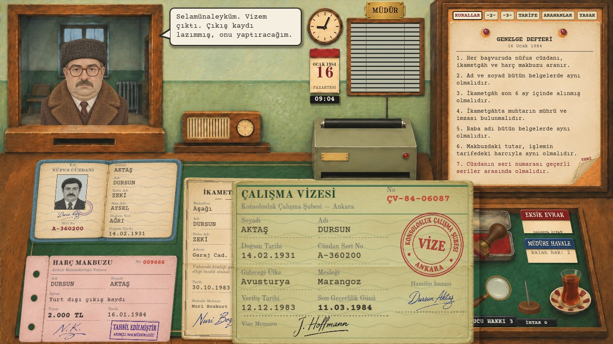

Altıncı günden itibaren gişeye yurt dışına işçi gidenler de gelir. **Yurt dışı çıkış kaydı** için
dördüncü bir belge aranır: çalışma vizesi. Vizenin numarası geçerli aralıkta, konsolosluk kaşesi
gerçek, süresi dolmamış olmalı; üstündeki seri numarası, doğum tarihi ve imza cüzdandakiyle aynı
olmalıdır.

### Fotoğraf eskidir, yüz aynıdır

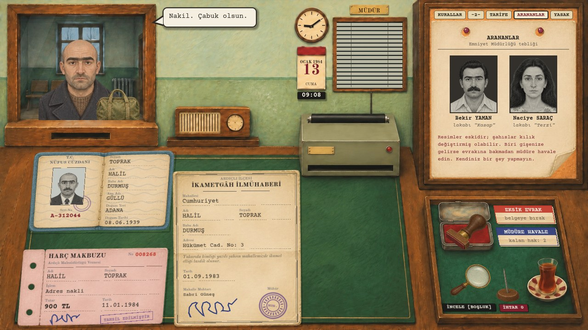

Nüfus cüzdanındaki vesikalık yıllar önce çekilmiştir: sahibi bugün başka giyinir, saçını başka
tarar, bıyığını kesmiş ya da bırakmıştır, şapkası vardır. Fotoğrafın camdaki kişiye ait olup
olmadığı yüz hatlarından anlaşılır: burun, göz, kaş, çene. Sahte cüzdandaki fotoğraf da rastgele
biri olmaz; başvurana en çok benzeyen kişilerden birine aittir ve günler ilerledikçe benzerlik artar.

Emniyetin arananlar listesindeki resimler de eski dosya resimleridir. Aranan şahıs gişeye kılık
değiştirmiş gelir; arada bir, listedeki resme benzeyen masum bir vatandaş da gelir.

### Röntgen cihazı

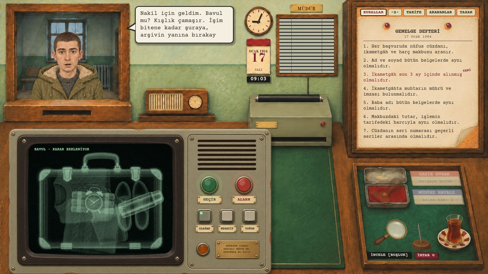

Beşinci günden itibaren gişeye bir röntgen cihazı kurulur. Çantayla gelen vatandaşın evrakından
önce çantası banttan geçer: eşikteki çantaya tıklarsınız, cihaz masanın önüne yükselir ve çantanın
içini tüplü ekranda gösterir.

- **GEÇİR** (yeşil): çanta temizse.
- **ALARM** (kırmızı): yasak eşya görürseniz. Bekçi çantayı açar.
- **OLAĞAN / NEGATİF / YOĞUN:** görüntü kipleri. "Yoğun" yalnızca maden parçaları bırakır.

Cihaz neyin yasak olduğunu söylemez; bakıp tanımak sizin işinizdir. Yasak eşyanın röntgendeki
görünüşü genelge defterinin **YASAK** sayfasındadır. Çantalarda yanıltıcı eşya da bulunur: saç
kurutma makinesi tabancaya, sucuk dinamite, bir bağ mum patlayıcıya benzer.

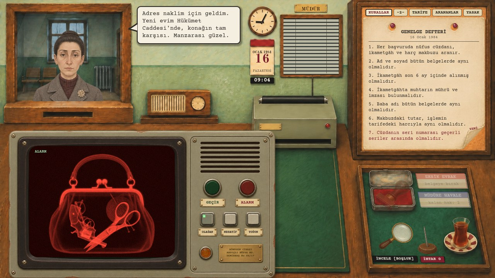

| Durum | Sonuç |
|---|---|
| Yasak eşyaya alarm | Prim ve şüpheli primi; şahıs götürülür, evrakına bakılmaz |
| Yasak eşyayı geçirmek | Vatandaş gişeden ayrılırken ihtar (müdür izliyorsa çift) |
| Temiz çantaya alarm | Mesaiden 12 dakika gider; günün ikinci boş alarmı ihtardır |

| Tuş | İşlev |
|---|---|
| Fare ile sürükle | Belgeyi masada taşır (tutulan nesne öne çıkar, imleç el olur) |
| Çift tık | Belgeyi büyütür, küçültür |
| BOŞLUK | İnceleme modu |
| ESC | Çay molası: oyun durur, ayarlar açılır |
| F11 | Tam ekran |
| F12 | Ekran görüntüsü |

### Gişedeki insanlar


Vatandaşlar camın ardında yürüyerek gelir, konuşur, beklerken nefes alır ve göz kırpar. Sabırları
taşınca öfleyip pöflerler. Kararınıza sevinir, üzülür ya da şaşırırlar.
Aranan, sahteci ya da yasak eşya taşıyan şahıs yakalanınca iki görevli cama dalar; şahıs korkar,
bağırır, yere yatırılır ve götürülür. Konuşma, her yüz için ayrı
ayrı boyanmış ağız kareleriyle canlandırılır; sesi kısa, anlaşılmaz bir mırıltıdır ve kişinin yaşına,
cinsiyetine göre incelip kalınlaşır.

Kuyruk her gün başka insanlardan oluşur. Oyunda hikâye kişileriyle birlikte **89 ayrı yüz** vardır;
her yüz kalıcı bir kişidir: adı, ana ve baba adı, doğum yeri ve tarihi, imzası hep aynıdır. Cüzdanda
sahibinin imzası durur.

### Diller

Oyun Türkçe, İngilizce ve Rusça oynanabilir (ayarlar → OYUN → Dil; ilk açılışta sistemin dili seçilir).
Kaynak metin Türkçedir; çeviriler `data/dil/<dil>.json` sözlüklerindedir. Yazılı görsellerin dile özgü
hâlleri `assets/img/nesne/<dil>/` ve `assets/img/damga/<dil>/` altındadır. Kişi, mahalle, il adları ve
belge numaraları çevrilmez.

Çeviri hattı: `python tools/dil/cikar.py` metinleri numaralar (`tools/dil/kaynak.json`), çeviriler
`tools/dil/ceviri/*.json` dosyalarına yazılır, `python tools/dil/derle.py` yer tutucuları ve satır
sayılarını denetleyip sözlükleri kurar. `bash tools/dil/tara.sh <dil> <klasör>` bütün çekim senaryolarını o
dilde çalıştırır; günlükte Türkçe kalan (`TR?`) ve alanına sığmayan (`TAS`) yazılar listelenir.
`bash tools/cek.sh balon` bütün konuşmaların üç dilde balona sığdığını denetler.

### Akşam evde

Akşam odası canlıdır: nine örgü örer, Elif ödevini yazar, Can kamyonunu sürer; pencerenin ardında kar
yağar, soba harlı yanar, ocaktaki tencere tüter. Kömür alınmazsa soba söner, oda soğur; hasta olan
aile üyesi elindeki işi bırakır.

### Güne başlarken: kasabadan kareler

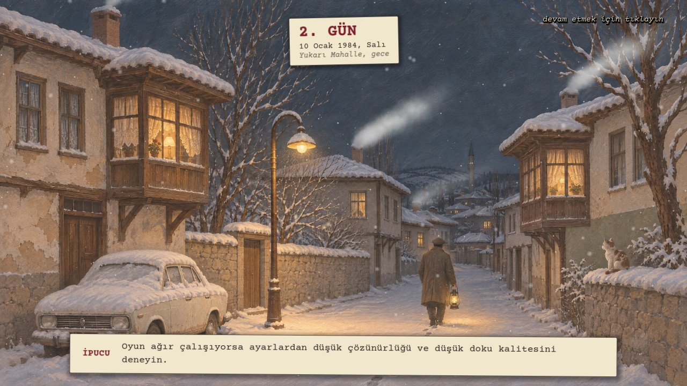

Oyuna başlarken ve her yeni günün sabahında, masaya oturmadan önce Ardıçlı'dan bir sahne görünür:
çarşı sokağı, bağ yolundan kasabanın görünüşü, çınarlı meydan, taş köprü, istasyon, pazar yeri,
gece vakti yukarı mahalle, müdürlüğün önü. Sahneler ana menüdeki gibi canlıdır: kar yağar, bacalar
tüter, sokak lambası ve ışıklı pencereler hafifçe titrer. Altta o güne kadar öğrenilen konulardan bir
ipucu durur; bekledikçe sahne de ipucu da değişir. Tıklayınca (ya da BOŞLUK, ENTER, ESC) masa açılır.
Ayarlardan "kısa" (birkaç saniyede kendiliğinden geçer) ya da "kapalı" seçilebilir.

### Müdür izliyor


Müdür Cevdet Bey günün belirli saatlerinde odasının jaluzisini açıp gişeyi izler. O bakarken
yapılan hata **çift ihtar** sayılır.

---

## Bir haftanın hikâyesi

Oyun 9 Ocak 1984 Pazartesi sabahı başlar ve 17 Ocak Salı akşamı biter. Bu yedi iş gününde ilçe
giderek karışır; her sabah genelgenin yanında "Ardıçlı Postası"ndan bir kupür durur.


Gişeye rastgele vatandaşların arasında, hikâyenin kişileri de gelir:

- **Hüsnü Amca**, yatılı okulu kazanan torunu Yusuf için kayıt örneği almaya çalışır. Her gün
  gelir; kâğıdı her gün başka bir yerinden eksiktir. Onaylamak ihtara mal olur.
- **Nermin Hanım** karşı komşunuzdur. "Aramızda kalsın" der; akşam sofranıza bir tencere yemek yollar.
- **Ev sahibi İzzet Bey** kirayı da gişedeki işini de aynı cümlede anar.
- **Müteahhit Kenan Bey** masaya bir zarf bırakır. Çekmeceye atabilir ya da geri itebilirsiniz.

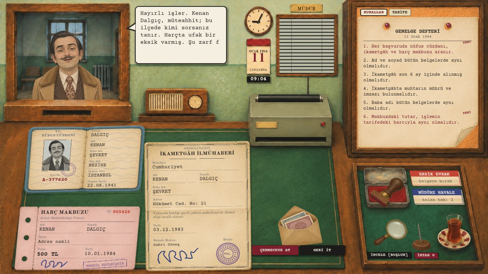

- **Savcı Hikmet Altay** sahte cüzdan dosyasına bakmak için ilçeye gelir.
- **Gözlüklü adam** sokağın başındaki beyaz arabadan iner; gişeye bir kereden fazla uğrar.
- Dördüncü günden itibaren genelge defterinde emniyetin aradığı iki kişinin eski resimleri
  durur. Onları gişede tanırsanız yapılacak tek şey müdüre havale etmektir. Çantaları da bir şey
  söyler: birinin torbasında satır, ötekinin el çantasında dikiş makasından fazlası vardır.
- Altıncı gün **tarlasını satıp vize alan bir genç** gelir; vizesindeki kaşe defterdekine benzemez.
- Son gün vizesinin süresi bir gün önce dolmuş **bir dökümcü ustası** ve **bavullu bir genç** gelir;
  genç, bavulunu arşivin yanına bırakmak ister.


Kimi kayırdığınız, kimi geri çevirdiğiniz ve kimi fark ettiğiniz oyunun sonunu belirler.

Bütün kişi, kurum ve olaylar kurmacadır. Bombalama ve suikast yalnızca gazete haberi ve gece notu
olarak, yazıyla geçer.

---

## Kurallar gün gün

Kurallar birikir: bir gün konan kural sonraki günlerde de geçerlidir.

| Gün | Tarih | Kuyruk | O gün eklenen |
|---|---|---|---|
| 1 | 9 Ocak Pzt | 8 kişi | Nüfus cüzdanı ve ikametgâh ilmühaberi aranır. Ad ve soyad bütün belgelerde aynı olmalı. İlmühaber son 6 ay içinde alınmış olmalı. |
| 2 | 10 Ocak Sal | 9 | İlmühaberde muhtarın mührü ve imzası olmalı. Baba adı bütün belgelerde aynı olmalı. Müdür denetimi başlar. |
| 3 | 11 Ocak Çar | 10 | Harç makbuzu aranır; tutar tarifeye uymalı (kayıt örneği 250, cüzdan yenileme 1.250, nakil 750 TL). |
| 4 | 12 Ocak Per | 10 | Seri numarası geçerli aralıkta olmalı (A-100000 – A-499999). Fotoğraf başvurana ait olmalı. Mühür, imza ve kaşeler bilgi defterindeki örneklere uymalı. Arananlar listesi. |
| 5 | 13 Ocak Cum | 11 | Harç zammı (300 / 1.500 / 900 TL). Makbuz en çok 3 günlük olmalı. Röntgen cihazı: ateşli silah, mermi ve patlayıcı yasak. |
| 6 | 16 Ocak Pzt | 12 | İlmühaber ilçeye bağlı bir mahalleden alınmış olmalı (Dere ve Değirmen çıkarıldı). B serisi cüzdanlar da geçerli. Yeni işlem: yurt dışı çıkış kaydı (harcı 2.000 TL); çalışma vizesi aranır. |
| 7 | 17 Ocak Sal | 12 | Teftiş günü. İlmühaberin geçerlilik süresi 3 aya iner. Röntgende bıçak, kama ve satır da yasak. |

Röntgen günlerinde vatandaşların yaklaşık yüzde 45'i çantayla gelir; çantaların üçte birine
yakınında yasak bir eşya, yarıdan fazlasında yanıltıcı bir eşya bulunur.

Vatandaşların yaklaşık yüzde 40–50'si kusurlu evrakla gelir; oran günden güne artar. Kusurlar:
eksik belge, uyuşmayan ad-soyad, uyuşmayan baba adı, süresi geçmiş belge, eksik mühür ya da imza,
yanlış harç, geçersiz seri numarası, başkasına ait fotoğraf, ilçeye bağlı olmayan mahalle; dördüncü
günden itibaren sahte mühür, başkasının attığı imza ve sahte vezne kaşesi; altıncı günden itibaren
vizenin numarası, kaşesi, süresi, kimlik bilgileri ve imzası.

Seri numarası, fotoğraf ve sahte mühür, imza, kaşe kusurları sahtecilik sayılır: bunları müdüre
havale etmek ek prim getirir.

---

## Geçim

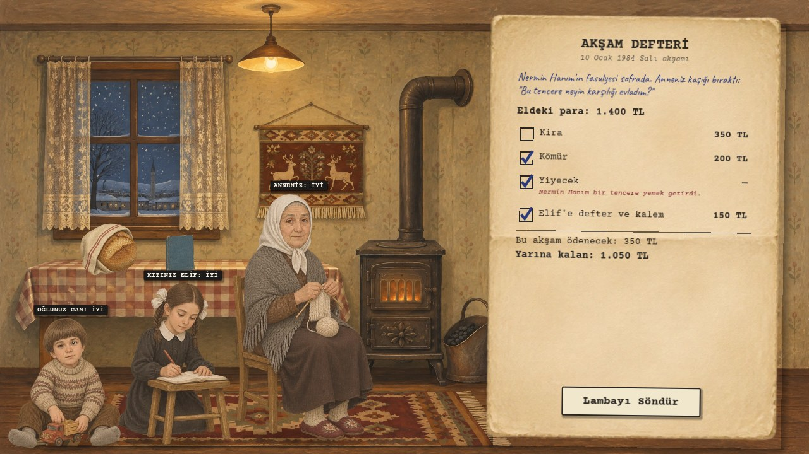

| Gelir | |
|---|---|
| Yevmiye | 350 TL |
| Doğru işlem primi | 100 TL |
| Sahteciliği havale etme primi | +50 TL |
| Günde 3. ihtarda kesinti | −200 TL, sonraki her ihtar −100 TL |

| Gider (her akşam) | |
|---|---|
| Kira | 350 TL (üç akşam ödenmezse tahliye) |
| Kömür | 200 TL (alınmazsa ev soğur) |
| Yiyecek | 250 TL (alınmazsa herkes aç yatar) |
| İlaç | 300 TL (hasta olana; annenin tansiyon ilacı 3. ve 6. akşam) |
| Okul | 150 / 200 / 400 TL (2., 4. ve 6. akşam) |

Oyuna 500 TL ile başlanır. Evde anneniz Hacer Hanım, kızınız Elif (8) ve oğlunuz Can (4) yaşar.
Soğuk ve aç geçen geceler sağlıklarını bozar; hasta olan ilaçsız kalırsa ağırlaşır. İşaretlediğiniz
kalem anında odaya yansır: soba yanar, sofraya ekmek gelir.

---

## Sonlar

Oyunun yedi sonu vardır. Hepsi "Ardıçlı Postası"nın birinci sayfası olarak gösterilir; yan haberler
hikâyedeki öbür kişilerin akıbetini anlatır.

<details>
<summary>Sonların koşulları (sürprizi bozar)</summary>

| Son | Koşul |
|---|---|
| **Terfi** | Yedi gün tamamlanır; toplam ihtar en çok 6, şüphe en çok 1 |
| **Yerinde** | Yedi gün tamamlanır ama ihtar ya da şüphe fazladır |
| **Sürgün** | Toplam ihtar 14'e varır |
| **Açığa alınma** | Zarflar ve kayırmalarla şüphe 4'e varır |
| **İflas** | Para eksiye düşer |
| **Hastalık** | Aileden biri ağır hastalanır |
| **Tahliye** | Kira üç akşam üst üste ödenmez |

Yan haberler: savcının akıbeti (arananlardan kaçını gişede yakaladığınıza bağlıdır), Yusuf'un okul
kaydı, başkomiserin raporu. Hüsnü Amca'nın kâğıdını bir kez olsun geçirdiyseniz sonda mektubu durur.


</details>

---

## Kurulum ve çalıştırma

1. [Godot 4.3 (standart sürüm)](https://godotengine.org/download/archive/4.3-stable/) indirin.
2. Godot'u açın → **İçe Aktar (Import)** → bu klasördeki `project.godot` dosyasını seçin.
3. İlk açılışta Godot varlıkları içe aktarır. Sonra **F5** ile oyunu başlatın.

Komut satırından:

```bash
godot --path . --import      # ilk kurulumda bir kez
godot --path .               # oyunu başlatır
```

Kayıt ve ayarlar kullanıcı klasöründe durur (`user://kayit.json`, `user://ayarlar.json`;
Windows'ta `%APPDATA%\Godot\app_userdata\Nöbetçi Memur\`).

### Sistem gereksinimleri

Oyun 2B'dir ve Godot'un en hafif çizicisiyle (Compatibility, OpenGL 3.3) çalışır. Aşağıdaki alt
sınırlar Godot 4.3'ün dışa aktarılmış oyunlar için verdiği gereksinimlerdir; oyunun kendi ölçümleri
bunların çok altında kalır (bkz. [Performans](#performans)).

| | En az |
|---|---|
| İşletim sistemi | Windows 7 ve üstü (64 bit ya da 32 bit; ikisinin de paketi vardır). Windows 10 öncesi için motorun desteği "elden geldiğince"dir. |
| İşlemci | SSE2 destekli herhangi bir x86 işlemci |
| Ekran kartı | OpenGL 3.3 destekleyen tümleşik grafik (Intel HD 2500 ve sonrası). OpenGL sürücüsü eski ya da sorunluysa oyun kendiliğinden Direct3D 11 üstünden (ANGLE) çalışır. |
| Bellek | 2 GB (oyunun kendisi 200–300 MB kullanır) |
| Disk | 250 MB |
| Ekran | 1280×720 |
| Tarayıcı (Web) | Firefox 79, Chrome 68, Edge 79, Safari 15.2 ve sonrası; 4 GB bellek |

Bu sınırlar zayıf bir bilgisayarda elle denenmedi; geliştirme makinesindeki ölçümlere ve motorun
belgelerine dayanır.

### Ayarlar

Ana menüden ve moladan (ESC) açılan dört yapraklı bir formdur; hepsi `user://ayarlar.json` içinde saklanır.

| Yaprak | Ayarlar |
|---|---|
| **SES** | Genel ses, efektler, konuşma, müzik, ortam (soba, rüzgâr) düzeyleri; müziği açıp kapatma |
| **GÖRÜNTÜ** | Tam ekran, pencere boyutu (1280×720, 1600×900, 1920×1080), dikey eşleme, kare sınırı (30, 60, 120, yok), efekt kalitesi (kar ve duman yoğunluğu), doku kalitesi, düşük çözünürlük, otomatik kalite |
| **OYUN** | Mesai saatinin hızı, yazı hızı (genelge, konuşma, teleks), geçiş ekranı (tıkla geç, kısa, kapalı), arka planda kendiliğinden mola, ekran sarsıntısı, titreyen ışıklar, fare hassasiyeti |
| **KONTROLLER** | Tuşlar ve fare hareketleri |

Zayıf bilgisayarlar için üç ayar vardır. **Doku kalitesi** "düşük" iken arka planlar yarı
çözünürlükte yüklenir (ekran belleği azalır). **Düşük çözünürlük** açıkken oyun 1280×720 çizilip
pencereye büyütülür: büyük ekranlı zayıf ekran kartlarında boyanan nokta sayısı kat kat düşer.
**Otomatik kalite** açıkken (varsayılan) oyun kare hızını izler; on saniye boyunca düşük kalırsa
kaliteyi bir kademe kısar: önce kar ve duman, sonra çözünürlük, sonra doku, en son kare sınırı 30.
Az çekirdekli ya da 4 GB'tan az bellekli bilgisayarda oyun ilk açılışta düşük ayarlarla başlar.
Işığa duyarlı olanlar "titreyen
ışıklar"ı ve "ekran sarsıntısı"nı kapatabilir. Tarayıcıda pencere, dikey eşleme ve imleç tarayıcının
elinde olduğundan o satırlar gösterilmez. "Varsayılana dön" bütün ayarları sıfırlar.

### Kayıt nasıl işler

Oyun kendiliğinden kaydeder; elle kayıt yoktur. Üç kayıt anı vardır:

| An | Kayıttan dönünce |
|---|---|
| Sabah (gün başı) | Gün baştan oynanır. Gişe bir kez açıldıysa kuyruk başka vatandaşlarla kurulur. |
| Mesai kapanınca | Puantaj ekranı gelir: günün parası, ihtarları ve sonucu yerindedir. |
| Akşam ışık sönünce | Ertesi sabah (ya da oyun bittiyse son ekranı) gelir. |

Bu düzen, kötü geçen günü oyundan çıkıp silmeyi ve aynı kuyruğu ezberleyip baştan oynamayı önler.
Mola (ESC) sırasında masa görünmez: saat dururken evrak okunamaz. Pencere arka plana geçince (tarayıcıda
sekme gizlenince) oyun kendiliğinden mola verir; bu, ayarlardan kapatılabilir.

Kayıt dosyası imzalıdır. Elle değiştirilen ya da bozulan dosya kayıt sayılmaz; bir önceki kayıt
(`kayit.json.yedek`) varsa ondan sürülür. Yazma önce geçici dosyaya yapılır: yarıda kesilen bir
yazma eldeki kaydı bozmaz. İmza anahtarı oyunun paketindedir; paketi açan biri onu bulabilir, yani
imza gündelik kurcalamayı ve bozulmayı yakalar, kararlı birini durdurmaz. Ayar dosyasındaki değerler
okunurken geçerli aralıklara çekilir.

## Dışa aktarma ve yayın

Windows ve Web ön ayarları `export_presets.cfg` içindedir.

```bash
python tools/sablon_indir.py     # dışa aktarma şablonlarından yalnız gerekenleri indirir (bir kez)
bash tools/disa_aktar.sh         # build/ altına üç yapıyı ve yüklemeye hazır zip dosyalarını çıkarır
python tools/web_dene.py         # Web yapısını başsız Chrome'da açıp dener (isteğe bağlı)
```

| Çıktı | İçerik |
|---|---|
| `build/NobetciMemur-windows.zip` | Tek dosyalık `NobetciMemur.exe` (paket içine gömülü), 64 bit |
| `build/NobetciMemur-windows-32bit.zip` | Aynısının 32 bit hâli: eski bilgisayarlar için |
| `build/NobetciMemur-web.zip` | `index.html` ve eşlikçileri; itch.io'ya doğrudan yüklenir |

Web yapısı iş parçacıksız şablonla üretilir: özel sunucu başlığı (COOP/COEP) gerektirmez.

Exe dosyasının simgesi ve sürüm bilgisi [rcedit](https://github.com/electron/rcedit) ile yazılır;
yolu Godot'un düzenleyici ayarlarında (`export/windows/rcedit`) tanımlı olmalıdır. Tanımlı değilse
dışa aktarma yine tamamlanır, exe Godot'un simgesiyle çıkar. Simge (`icon.png`, `icon.ico`) ve açılış
görseli (`assets/img/acilis.png`) logodan `python tools/sanat/logo.py` ile kurulur.

Yayın belgeleri `docs/` klasöründedir:

- [`docs/itch-sayfasi.md`](docs/itch-sayfasi.md): itch.io sayfa metni (Türkçe ve İngilizce) ve sayfa ayarları
- [`docs/ekran-goruntuleri.md`](docs/ekran-goruntuleri.md): üç ekran görüntüsü için talimat
- [`docs/surum-notlari.md`](docs/surum-notlari.md): sürüm notları
- [`docs/kontrol-listesi.md`](docs/kontrol-listesi.md): yedi günlük oynanış kontrol listesi

## Performans

`bash tools/cek.sh performans` sahnelerin kare sürelerini dikey eşleme kapalıyken ölçer. Geliştirme
makinesinde bütün sahneler kare başına 1–3 ms sürer; ölçülen ve giderilen darboğazlar şunlardı:

- **Vatandaş değişimindeki takılma.** Yüz, vesikalık ve konuşma kareleri vatandaş cama geldiği anda
  yükleniyordu (en uzun kare 32 ms). Kuyruğun görselleri artık gün başından itibaren kare başına bir
  tane yüklenir (en uzun kare 16 ms).
- **Büyüyen doku belleği.** Yüklenen yüzler oyun boyunca bellekte kalıyordu. Her gün başında ve mesai
  bitince önceki yüzler bırakılır; bellek bir günün kuyruğuyla sınırlıdır.
- **Paket boyutu.** Görseller kayıplı WebP olarak saklanır ama kayıpsız içe aktarılıyordu: pakette üç
  kat yer tutuyorlardı. Fotoğraf benzeri görseller artık kayıplı (kalite 0,92) aktarılır
  (`python tools/ice_aktarma.py`); ölçülen fark en kötü görselde 42,7 dB PSNR'dir
  (`python tools/sanat/kalite_olc.py`). Röntgen haritaları, imzalar ve damgalar kayıpsız kalır.
  `python tools/boyut.py` paketin dökümünü verir.
- **Kayan yükleme penceresi.** Kuyruğun tamamı yerine yalnızca sıradaki üç vatandaşın görselleri
  yüklenir; gişeden ayrılanın görselleri bırakılır. Masadaki doku belleği 103 MB'tan 87 MB'a indi.
- **Zayıf sistem ayarları.** Doku kalitesi, düşük çözünürlük ve otomatik kalite (bkz. [Ayarlar](#ayarlar)).
  Kullanılmayan fizik motorları kapalıdır (`project.godot` → `physics`).
- **Yedek çizici.** OpenGL yerine Direct3D 11 (ANGLE) üstünde de ölçüldü: masa kare başına 3–5 ms.
  `python tools/doku_bellegi.py` görsellerin ekran belleğindeki yerini klasör klasör döker;
  performans ölçümü sürecin toplam belleğini de yazar (170–215 MB).
- Duvar saati ibre gözle görülür kadar ilerleyince yeniden çizilir; kar ve duman yoğunluğu efekt
  kalitesi ayarına uyar.

## Proje yapısı

```
scenes/            Sahneler: AnaMenu, Masa, GunSonu, Aile, Son (+ belgeler/, UreticiTesti)
scripts/           Oyun kodu (aşağıda)
data/              İçerik: günler, adlar, portre künyeleri, vatandaşların sabit kimlikleri, karakterler,
                   hikâye, eşyalar (JSON)
assets/img/        Arka planlar, kasaba sahneleri (kasaba/), portreler (+ ağız kareleri, vesikalıklar, aranan resimleri), nesneler,
                   kâğıt dokuları, röntgen (cihaz, çanta kabukları, eşyalar), imzalar, mühür ve kaşeler
assets/ses/        Gerçek kayıtlardan kesilmiş efektler (.wav), döngülü ortam sesleri (.ogg),
                   muzik/ altında çalgı müzikleri; künyeler KAYNAKLAR.md içinde
assets/video/      Aile üyelerinin canlandırma videoları (Theora; renk ve saydamlık yan yana)
assets/font/       Courier Prime, Old Standard TT, Caveat (+ lisans metinleri)
assets/shader/     portre.gdshader (canlı portre), foto.gdshader (vesikalık baskı),
                   rontgen_esya.gdshader ve rontgen_ekran.gdshader (röntgen görüntüsü)
tools/             Testler, ekran görüntüsü düzeneği, görsel hazırlama ve ses derleme betikleri
docs/              Yayın belgeleri ve README görselleri
```

Sahnelerin `.tscn` dosyaları yalnızca kök düğümü ve betiği taşır; arayüz kodla kurulur. Sahne
akışı: `Ana Menü → Masa (09:00–17:00) → Gün Sonu → Aile → ertesi gün … → Son`.

### Başlıca betikler

| Dosya | Görev |
|---|---|
| `Oyun.gd` (autoload) | Oyun durumu (gün, para, ihtar, şüphe, bayraklar), kayıt, ayarlar, sahne geçişi, mola |
| `Ses.gd` (autoload) | Efektler (çok kayıtlı olanlardan her seferinde biri), ortam sesleri, müzik çalma listesi, radyo tınısı |
| `Masa.gd` | Mesai: kuyruk, belgeler, kararlar, teleks, zarf, müdür denetimi, çanta denetimi |
| `Rontgen.gd` | Röntgen cihazı: çantanın görüntüsünü kurar, görüntü kipleri, geçir / alarm düğmeleri |
| `Canta.gd` | Çanta ve eşya kataloğu, rastgele çanta üretimi, günün yasakları |
| `Portreler.gd` | Büst, vesikalık ve aranan resimleri; benzerlik listeleri |
| `Dogrulayici.gd` | Kural motoru: evrakı günün kurallarına göre denetler, kararı değerlendirir, inceleme karşılaştırmaları |
| `VatandasUretici.gd` | Tutarlı vatandaş ve evrak üretir; istenen kusuru enjekte eder |
| `Hikaye.gd` | Hikâye karakterleri, koşullar, etkiler, gazete, akşam ve gece metinleri, sonlar |
| `AileDurumu.gd`, `Aile.gd` | Evin ekonomisi ve sağlık; akşam sahnesi |
| `belgeler/Belge.gd` (+ dört belge) | Sürükleme, büyütme, inceleme hedefleri, karar izleri; dördüncü belge çalışma vizesi |
| `belgeler/BilgiDefteri.gd` | Masadaki bilgi defteri: mühür, imza, kaşe ve vize yaprakları; örnekler inceleme hedefidir |
| `Damga.gd` | Mühür ve kaşeler: gerçek ve sahte çeşitleri, mürekkep rengi |
| `IncelemeKatmani.gd` | İnceleme modu: karşılaştırma çizgisi, sonuç balonu, ipucu hakkı |
| `Perspektif.gd`, `MasaNesnesi.gd` | Masanın perspektifi: nesneler masada yatar, ele alınınca düzleşir |
| `CanliPortre.gd` | Nefes, göz kırpma, konuşma, yürüyüş, tepkiler |
| `Teleks.gd`, `IhtarFisi.gd` | İhtar, uyarı ve notların satır satır basılması |
| `KuralKitabi.gd` | Panodaki genelge defteri: kurallar, tarife, arananlar, yasak eşya |
| `GenelgeEkrani.gd`, `Gazete.gd` | Sabah genelgesi ve gazete kupürü |
| `GunSonu.gd`, `Son.gd` | Günlük puantaj; oyun sonu gazetesi |
| `AnaMenu.gd`, `AyarlarPenceresi.gd`, `MolaMenusu.gd` | Menüler; ana menüde baca dumanı ve cızırdayan sokak lambası |
| `Kar.gd` | Üç katmanlı, rüzgârla savrulan kar yağışı |
| `EvCanlandirma.gd` | Akşam odası: pencere karı, soba ateşi (`soba_atesi.gdshader`), kıvılcım, ocaktaki kap ve buharı |
| `VideoFigur.gd` | Aile üyelerinin canlandırma videolarını saydam zeminle oynatır (`video_figur.gdshader`, `data/figur_videolari.json`) |
| `DuvarSaati.gd` | Kadranın boyalı ibreleri, günün takvim yaprağı, kartları dönen çevirmeli saat |
| `AraEkran.gd` | Güne başlarken geçiş ekranı: kasaba sahneleri ve ipuçları (`data/ara_ekran.json`) |
| `KasabaSahnesi.gd` | Boyalı bir sahneyi canlandırır: baca dumanı, lamba ve pencere ışığı, ağır yaklaşma; ana menünün dumanı da buradan gelir |
| `Gorsel.gd` | Arka planları doku kalitesi ayarına göre tam ya da yarı çözünürlükte yükler |
| `Imza.gd` | Kişiye özel imzalar: müdür, muhtarlar, veznedar, vize memuru ve bütün vatandaşlar |
| `Serit.gd` | Masadaki kabartma şerit etiketler |
| `Stil.gd`, `Yerlesim.gd` | Renkler ve yazı tipleri; ekran yerleşimi sabitleri |

## İçerik eklemek

Oyunun içeriği veridir; kod değiştirmeden genişletilebilir.

- **Yeni gün ya da kural:** `data/gunler/gunN.json`. Kural türleri: `belge_zorunlu`, `alan_esit`,
  `tarih_sure`, `muhur_zorunlu`, `harc_tutar`, `seri_aralik`, `foto_eslesme`, `mahalle_listesi`,
  `arananlar`, `sahtecilik`, `vize` (`islem`: vize aranan işlem; `no`: geçerli numara aralığı),
  `canta_kontrol` (`yasak`: o gün yasak eşya sınıfları). `denetim` alanı müdürün
  izlediği saat aralıklarını (dakika), `canta_orani` çantayla gelenlerin, `yasak_orani` yasak eşya
  taşıyan çantaların oranını verir.
- **Yeni kasaba sahnesi ya da ipucu:** `data/ara_ekran.json`. Sahnenin resmi (16:9) `tools/sanat/ham/kasaba/`
  altına konur, `python tools/sanat/kasaba.py` onu `assets/img/kasaba/` altına hazırlar;
  `--izgara <ad> <çıktı.jpg>` bacaların, lambaların ve ışıklı pencerelerin yerini okumak için ızgaralı
  bir önizleme yazar. İpucunun `gun` alanı ilk görüneceği gündür.
- **Yeni eşya ya da çanta:** `data/esyalar.json`. Her eşyanın boyu, röntgendeki yoğunluğu, sınıfı
  (`kategori`) ve varsa neyi andırdığı (`benzer`) yazılır; görseli `assets/img/rontgen/esya/` altına konur.
- **Yeni hikâye karakteri:** `data/karakterler.json`. `kisiler` kimlik bilgilerini, `ziyaretler`
  geliş gününü, sırasını, evrakındaki kusuru (`alan`, `sil`), repliklerini ve kararın etkisini
  (`etki`: bayrak, şüphe, ikram, kira affı, müdür notu) tanımlar. `belgesiz` ziyaretçi yalnızca konuşur.
  `canta` ziyaretçinin röntgenden geçecek çantasıdır; `etki.alarm` ve `etki.gecir` çantadaki yasak
  eşyanın yakalanmasına ya da kaçmasına bağlanır.
- **Gazete, akşam ve gece metinleri, sonlar:** `data/hikaye.json`. Her kayıt bir `kosul` taşıyabilir;
  koşulu tutan ilk kayıt kullanılır.
- **İsimler ve replikler:** `data/adlar.json`.
- **Yeni yüz:** portresi, vesikalığı ve ağız kareleri `assets/img/portre/` altına, künyesi
  `data/portreler.json` dosyasına, sabit kimliği `data/vatandaslar.json` dosyasına, imzası
  `assets/img/imza/` altına eklenir (`tools/sanat/yeni_havuz.py`, `kadro.py`, `imzalar.py`).
- **Yeni ses:** `tools/ses/kaynaklar.json` dosyasına kaynağı ve kesim tarifi yazılır,
  `python tools/ses/topla.py <ad>` çalıştırılır. `ad_2`, `ad_3` diye adlandırılan kayıtlar aynı
  efektin çeşitlemeleri sayılır.

Yeni bir kural türü eklenirse üç yer güncellenir: `Dogrulayici.kontrol` (denetim),
`VatandasUretici.kusur_uygula` (kusurun üretimi) ve `Dogrulayici.karsilastir` (inceleme modu).
Üretici testi ikisinin uyuştuğunu denetler.

## Testler

```bash
godot --headless --path . res://tools/DumanTesti.tscn              # 408 denetim
godot --headless --path . res://scenes/UreticiTesti.tscn -- --cik  # 7 gün × 100 vatandaş
godot --headless --path . res://tools/TamOyun.tscn                 # yedi gün baştan sona
bash tools/statik_denetim.sh                                       # bütün betikler, uyarılar hata sayılarak
bash tools/saglamlik.sh                                            # sağlamlık testi (aşağıda)
```

- **Duman testi** sahneleri kodla gezer: gün döngüsü, maaş ve aile hesabı, kural motoru, belge
  sürükleme (gerçek fare olaylarıyla), hikâyedeki her ziyaretin kusuru, zarf, denetim, arananlar,
  mektup, sonlar, menü, ayarlar, mola; vesikalıklar ve benzerlik listeleri, 450 rastgele çanta,
  röntgen akışı (geçirme, yerinde alarm, boş alarm, kaçan bavul); görev şekilleri ve ipucu hakkı,
  bilgi defteri, sahte mühür, imza ve kaşeler, çalışma vizesi; ses dosyaları, çok kayıtlı efektler
  ve müzik çalma listesi.
- **Üretici testi** her gün için 100 vatandaş üretir; üreticinin koyduğu kusur ile doğrulayıcının
  bulduğu kusurun aynı olduğunu denetler.
- **Tam oyun testi** yedi günü gerçek sahne akışı üzerinden iki ayrı memurla oynar: kurallara
  uyan ve röntgende yasak eşyaya alarm veren memurun terfi etmesi, her evrakı onaylayıp her
  çantayı geçiren memurun sonunun kötü olması beklenir.

- **Statik denetim** bütün betikleri GDScript uyarıları hataya çevrilmiş olarak derler: kullanılmayan
  değişken, gölgelenen ad, gereksiz `await`, uyumsuz üçlü ifade gibi kusurlar derlemeyi durdurur.
- **Sağlamlık testi** oyunu bozmaya çalışır; bölümleri tek tek de çalıştırılabilir
  (`bash tools/saglamlik.sh kayit maymun`). Konsola düşen her betik hatası da başarısızlık sayılır.

  | Bölüm | Ne yapar |
  |---|---|
  | `veri` | Veri dosyalarını ve varlıkları çapraz denetler (yaklaşık 4.000 denetim): her yüzün görseli, vesikalığı, konuşma kareleri (iki ayrı, tam görünür kare), kimliği ve imzası; her kuralın alanları; her ziyaretin kişisi, işlemi, çantası; koşullarda okunan her bayrağı yazan bir yer; koddaki her ses, etiket ve dosya yolu. |
  | `ayarlar` | Her ayarın gerçekten uygulandığını (ses veriyolları, kare sınırı, efekt kalitesi, sarsıntı, yazı hızı, odak kaybı molası) ve ayar penceresindeki her düğmenin kendi ayarını yazdığını sınar. |
  | `kayit` | Kayıt ve ayar dosyalarını bozar: yarım JSON, yanlış türler, aşırı büyük ve çok derin dosya, geçersiz baytlar, elle değiştirilmiş içerik, imzası doğru ama değerleri düşmanca kayıtlar. Oyun çökmemeli, durum makul kalmalıdır. Kayıt aşamaları ve her hikâye bayrağının beklenmedik değerleri de burada sınanır. |
  | `uretici` | Üç görev şekli × beş tohum × yedi gün × 60 vatandaş (6.300): üreticinin koyduğu kusur ile doğrulayıcının bulduğu kusur aynı mı; aynı tohum aynı kuyruğu veriyor mu. |
  | `ipucu` | İnceleme modunda tıklanabilecek bütün hedef çiftlerini karşılaştırır (hedefler genelge defterinin ve bilgi defterinin gerçek düğümlerinden okunur): kusursuz evrakta hiçbir çift "uyuşmazlık" dememeli, her kusur en az bir karşılaştırmayla bulunabilmeli, sonuç tıklama sırasına bağlı olmamalıdır. |
  | `yerlesim` | Bütün yüzlerin kimlikleriyle kurulan belgelerde yazıların alanından taşmadığını, konuşmaların balona, en uzun pusulanın ekrana sığdığını ölçer. |
  | `akis` | Zamanlama yarışları: karar anında biten mesai, pencere açıkken kapanan gişe, aynı karede iki karar, hakkı bitmiş havale, bilgi defterine mühür, üst üste sahne geçişi, mola. |
  | `maymun` | Dokuz tur boyunca rastgele tıklar, sürükler, tuşlara ve düğmelere basar, karar araçlarını belgelere bırakır; her girdiden sonra oyun durumunun tutarlılığına ve kilitlenme olup olmadığına bakar. |

Ekran görüntüsü düzeneği pencereyi ekran dışında, odak almadan açar:

```bash
bash tools/cek.sh hikaye     # kareler tools/cikti/ altına yazılır
bash tools/cek.sh sinir      # ekranların en dolu hâlleri: puantaj, akşam defteri, son gazete, defter sayfaları, pencereler
bash tools/cek.sh ayarlar    # ayar penceresinin dört yaprağı
bash tools/cek.sh performans # sahnelerin kare süreleri ve vatandaş değişimindeki en uzun kare (konsola yazar)
bash tools/cek.sh genelge    # yedi günün genelgesi, yazısı tamamlanmış hâliyle
```

Başsız kipte yazı yüksekliği ölçümü güvenilir olmadığından, satırların sığıp sığmadığı bu karelere
bakılarak denetlenir. `python tools/olu_kod.py` çağrılmayan işlevleri ve bağlanmayan sinyalleri listeler.

Oyunun ses çıkışı da dosyaya kaydedilebilir (menü, genelge, gişe, gün sonu, akşam; bir dakika kadar):

```bash
godot --headless --path . res://tools/Cekim.tscn -- ses    # tools/cikti/ses_ornegi.wav
```

## Görsel ve ses üretim hattı

**Görseller** üretken yapay zekâ ile (Higgsfield üzerinden GPT Image) üretildi; oyuna aşağıdaki
betiklerle hazırlandı:

| Betik | İş |
|---|---|
| `tools/sanat/dilimle.py` | Portre ve nesne sayfalarını saydamlık kanalından tek tek görsellere ayırır |
| `tools/sanat/yuz_noktalari.py` | Her portrede göz, burun, ağız ve çene noktalarını bulur (OpenCV YuNet) |
| `tools/sanat/agiz_kareleri.py` | "Ağzı açık" çeşitlemeleri ana portreye hizalar; alt yüzü yumuşak maskeyle keser |
| `tools/sanat/logo.py` | Logoyu ham görselden temizler (mührün dolgusu, yıldızın boyu) ve mağaza kapaklarını kurar |
| `tools/sanat/figur_video.py` | Yeşil zeminde üretilmiş figür klibini döngüye sokar, zemini ayıklar, "renk + saydamlık" Theora videosuna çevirir |
| `tools/sanat/klip_duzelt.py` | Kamerası yakınlaşmış klibi özgün çerçevesine geri oturtur |
| `tools/sanat/yeni_varliklar.py` | Takvim yaprakları, saat parçaları, mutfak kapları, el pozları ve görevli büstlerini ham sayfalardan dilimler |
| `tools/sanat/ev_pencere.py` | Ev resminin penceresindeki boyalı (duran) kar tanelerini siler |
| `tools/sanat/kirpik_tara.py` | Dilimlenmiş görsellerde komşudan kalmış kesik parçaları arar ve temizler |
| `tools/sanat/daire_muhru.py` | Dairenin mühründeki eksik harfi tamamlar |
| `tools/sanat/kasaba.py` | Kasaba sahnelerini ham görsellerden 2560×1440'a hazırlar; yer bulmak için ızgaralı önizleme yazar |
| `tools/doku_bellegi.py` | Görsellerin ekran belleğinde tuttuğu yeri klasör klasör döker |
| `tools/sanat/ret_damgasi.py` | Ret mührünün izini eldeki boyalı damgaların harflerinden kurar; mühür aracının yeşil ve kırmızı lastikli hâllerini üretir |
| `tools/sanat/agiz_ara_kare.py` | Tek çeşitlemesi olan yüzlerde "hafif açık" kareyi açık kareden bükerek üretir (ağız boşluğunu daraltır) |
| `tools/sanat/aile_figurleri.py` | Ev sahnesindeki tam boy figürleri dilimler |
| `tools/sanat/vesikalik.py` | "Yıllar önceki hâli" çeşitlemelerinden vesikalıkları ve aranan resimlerini keser; yüz benzerliklerini ölçer (OpenCV SFace) |
| `tools/sanat/rontgen.py` | Röntgen eşyalarını, çanta kabuklarını, cihazı ve çantaların dış görünüşünü dilimler |
| `tools/sanat/imzalar.py` | İmza sayfasını kişi kişi keser; mürekkebin koyuluğunu saydamlık maskesine çevirir |
| `tools/sanat/damgalar.py` | Mühür ve kaşe sayfalarını (gerçek ve sahte çeşitler) keser; mürekkebi saydamlık maskesine çevirir |
| `tools/sanat/yeni_havuz.py` | Yeni portre sayfalarını dilimler, künyelerini ve benzerlik listelerini çıkarır |
| `tools/sanat/kadro.py` | Her yüze kalıcı bir kimlik verir: ad, ana-baba adı, doğum yeri ve tarihi (`data/vatandaslar.json`) |
| `tools/sanat/olc.py` | Arka plan üzerindeki yerleşim noktalarını ölçmek için cetvelli büyütme |

Canlı portrelerin hareketi tek bir gölgelendiricidedir (`assets/shader/portre.gdshader`): nefes,
baş eğimi, kaşlar, göz kapakları ve yanak şişmesi görseli büküp kaydırarak; konuşma ise boyanmış
ağız karelerini ana görselin üstüne bindirerek yapılır.

Vesikalıklar için her portre sayfası "aynı kişiler, yıllar önce, başka kıyafet ve saçla" yeniden
üretildi. Her kişi yüz noktalarına göre aynı kadraja oturtuldu; yüz tanıma modeliyle ölçülen
benzerlikte herkesin vesikalığı, başka herkesten çok kendi büstüne benziyor (ortalama 0,86).
Aynı ölçümden her kişinin "en çok benzeyenler" listesi çıkarıldı; sahte cüzdanlar bu listeyi kullanır.

Röntgen görüntüsü yoğunluk haritalarından kurulur: çantanın kabuğu ve eşyalar ayrı ayrı gri tonlu
görsellerdir, beyaz bir zemine çarpılarak üst üste biner (yoğunluklar birikir), ekran
gölgelendiricisi sonucu fosfor yeşiline boyar ve tarama çizgilerini ekler.

**Sesler** gerçek kayıtlardan derlenir. `tools/ses/kaynaklar.json` her sesin kaynağını ve kesim
tarifini tutar; `tools/ses/topla.py` kaydı indirir, tarife göre keser (tek olay, art arda olaylar,
kesit, döngü, konuşma heceleri, karışım), düzeyini ayarlar ve `assets/ses/` altına yazar. Kullanılan
her kaydın künyesi `assets/ses/KAYNAKLAR.md` dosyasına dökülür.

- **Efektler** Freesound'daki CC0 (kamu malı) kayıtlardan kesilmiştir: ıstampa mührü, kâğıt
  hışırtısı ve kayması, sayfa, resepsiyon zili, daktilo tuşları, kâğıt yırtılması, tahta zeminde
  ayak sesleri, iç çekiş, ahşap kepenk, jaluzi, uyarı zili, bozuk para, duvar saati, çekmece,
  dolma kalem ve imza, uzak patlama ve silah sesi, taşıma bandı, düğme, fabrika alarmı, floresan
  cızırtısı, soba çıtırtısı, pencereden ıslık çalan kış rüzgârı.
- **Konuşma** gerçek bir mırıltı kaydından kesilmiş on kısa hecedir; kişinin yaşına ve cinsiyetine
  göre inceltilerek çalınır. Sözcük seçilmez; yalnızca konuşanın sesi duyulur.
- **Müzik** çalgısaldır. Masadaki radyo sırayla şunları çalar: *Hüseyni Saz Semaisi* (kemençe ve
  ud; 1939 öncesi bir taş plak kaydı, kamu malı), *Harman Dalı* (Turku, Nomads of the Silk Road;
  CC BY 4.0), bir bağlama kaydı ve bir taksim (CC0). Menüde ve akşam evde ney duyulur (CC0).
  Radyodan gelen ses dar bantlı bir süzgeçten geçer.

Çok kayıtlı efektlerde (ayak sesi, hece, kâğıt, sayfa, daktilo) oyun her seferinde başka bir kaydı
çalar; ana çıkıştaki sınırlayıcı üst üste binen seslerin taşmasını önler.

```bash
python tools/ses/topla.py            # bütün sesleri yeniden derler (kaynaklar tools/ses/ham/ altında saklanır)
python tools/ses/topla.py muhur zil  # yalnızca adı verilenleri
```

## Emeği geçenler ve lisanslar

- **Motor:** [Godot Engine](https://godotengine.org) 4.3 (MIT)
- **Yazı tipleri:** Courier Prime, Old Standard TT, Caveat — SIL Open Font License 1.1
  (lisans metinleri `assets/font/` içinde)
- **Görseller:** üretken yapay zekâ ile üretilmiş, oyun için dilimlenip işlenmiştir.
- **Canlandırmalar:** aile üyelerinin hareketleri, kendi boyalı resimlerinden üretken yapay zekâ ile
  üretilmiş kısa kliplerdir (`assets/video/`).
- **Kasaba sahneleri:** üretken yapay zekâ ile, ana menü resmi üslup örneği verilerek üretilmiştir.
- **Logo:** üretken yapay zekâ ile üretilmiş, elle temizlenmiştir (`tools/sanat/logo.py`). Saydam hâli
  `docs/img/logo.png`, kâğıt üstündeki hâli `docs/img/logo_kagit.png`; mağaza kapakları
  `docs/img/kapak_920x430.jpg` (başlık görseli), `kapak_630x500.jpg` (itch.io) ve `kapak_1280x720.jpg`.
- **Ses efektleri:** [Freesound](https://freesound.org) üzerindeki CC0 1.0 (kamu malı) kayıtlar;
  kaydedenlerin tam listesi [`assets/ses/KAYNAKLAR.md`](assets/ses/KAYNAKLAR.md) içindedir.
- **Müzik:**
  - *Harman Dalı* — Turku, Nomads of the Silk Road (*Alleys of Istanbul* albümü),
    [CC BY 4.0](https://creativecommons.org/licenses/by/4.0/); Wikimedia Commons üzerinden alınmış,
    düzeyi eşitlenmiştir.
  - *Hüseyni Saz Semaisi* — Hafız Kemal Bey (kemençe) ve Hayriye Hanım (ud); 1939 öncesi kayıt,
    kamu malı (Gallica Digital Library, Wikimedia Commons üzerinden).
  - Bağlama, taksim ve ney kayıtları — Freesound, CC0 1.0.

Oyunun kodu, verisi, metinleri ve görselleri özel mülktür: **tüm hakları saklıdır** ([`LICENSE`](LICENSE)).
Depo herkese açıktır; kodu okuyabilirsiniz, ama kopyalamak, dağıtmak ya da başka bir üründe
kullanmak izne bağlıdır. Oyunu bu depodaki Releases ve web sayfasından indirip oynamak serbesttir.
Başkalarına ait bileşenlerin lisansları ve yükümlülükleri
[`UCUNCU-TARAF-LISANSLARI.md`](UCUNCU-TARAF-LISANSLARI.md) dosyasındadır.
