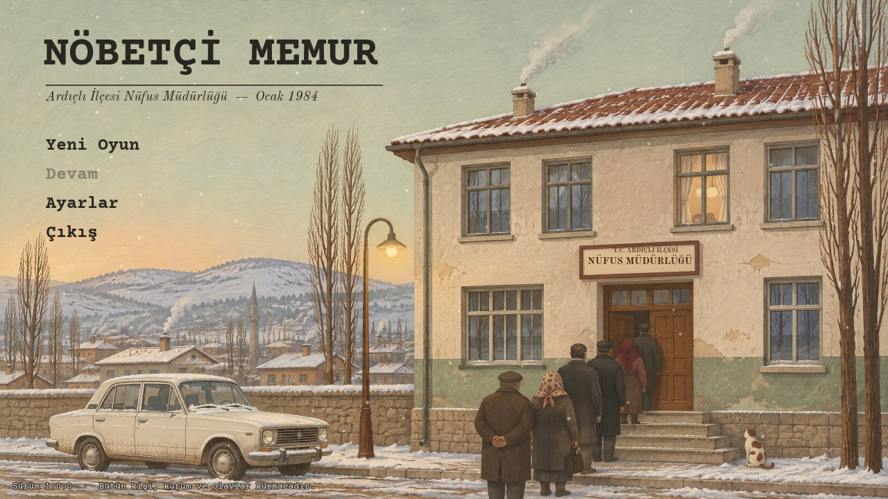
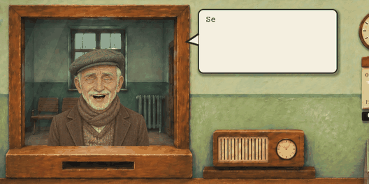
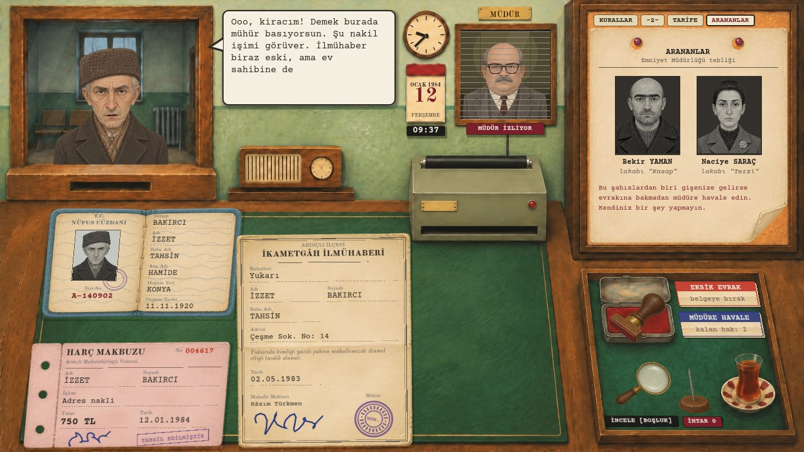
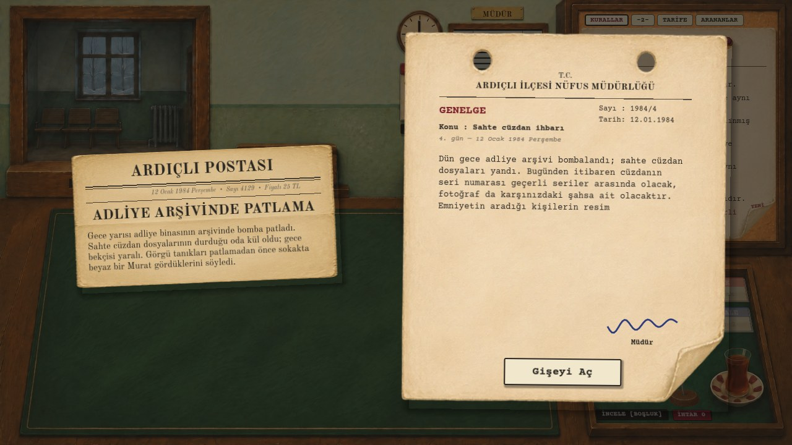
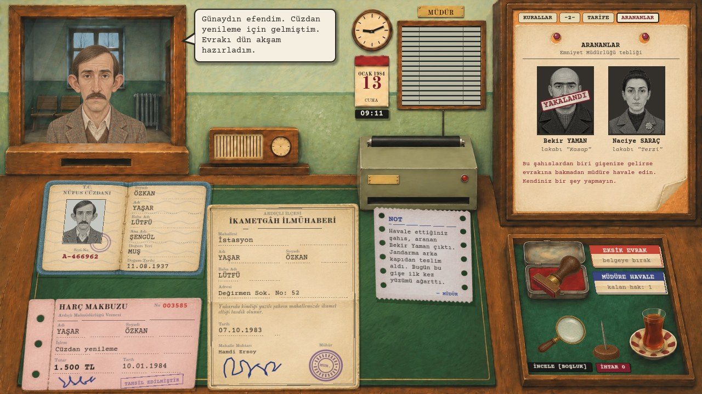
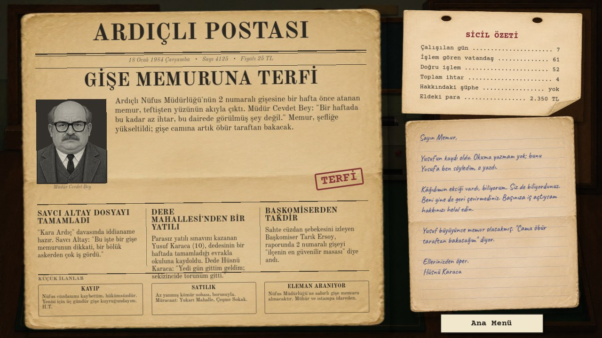

# Nöbetçi Memur

> **1984. Bir gişe, bir mühür, bitmeyen bir kuyruk.**



Ardıçlı İlçesi Nüfus Müdürlüğü'nün 2 numaralı gişesine yeni atanan memursunuz. Camın öbür
yanında kuyruk kapıya kadar uzuyor; herkesin elinde bir nüfus cüzdanı, bir ikametgâh ilmühaberi ve
çok önemli bir işi var. Sizin elinizde bir mühür, bir büyüteç ve müdürün her sabah değişen genelgesi.

Evrakı okur, **onaylar**, gerekçesiyle **geri çevirir** ya da **müdüre havale** edersiniz. Akşam
eve dönünce maaşı kira, kömür, yiyecek, ilaç ve okul masrafı arasında bölüştürürsünüz. Yedi iş
gününün sonunda başınıza gelen, gazetenin birinci sayfasında yazar.

Evrak kontrolü türünde, hüzünlü ve komik, tek kişilik bir hikâye oyunudur. Bir oynanış 45–60
dakika sürer. Godot 4.3 ile yazılmıştır; arayüzün tamamı Türkçedir.

| | |
|---|---|
| Motor | Godot 4.3 (GDScript), Compatibility çizici |
| Platform | Windows, Web (HTML5) |
| Çözünürlük | 1280 × 720 tasarım; her pencere boyutuna ölçeklenir |
| Dil | Türkçe |
| Sürüm | 1.0.0 |

---

## İçindekiler

- [Nasıl oynanır](#nasıl-oynanır)
- [Bir haftanın hikâyesi](#bir-haftanın-hikâyesi)
- [Kurallar gün gün](#kurallar-gün-gün)
- [Geçim](#geçim)
- [Sonlar](#sonlar)
- [Kurulum ve çalıştırma](#kurulum-ve-çalıştırma)
- [Dışa aktarma ve yayın](#dışa-aktarma-ve-yayın)
- [Proje yapısı](#proje-yapısı)
- [İçerik eklemek](#i̇çerik-eklemek)
- [Testler](#testler)
- [Görsel ve ses üretim hattı](#görsel-ve-ses-üretim-hattı)
- [Emeği geçenler ve lisanslar](#emeği-geçenler-ve-lisanslar)

---

## Nasıl oynanır


Her gün müdürün genelgesiyle başlar. Genelgeyi okuyup **Gişeyi Aç**'a basınca duvardaki saat
09:00'dan işlemeye başlar ve ilk vatandaş cama gelir. Belgeleri yarıktan masanıza kayar.

1. **Okuyun.** Belgeleri sürükleyin; çift tıklayınca elinize kalkıp büyürler.
2. **Karşılaştırın.** BOŞLUK tuşu ya da büyüteç inceleme modunu açar. İki bilgiye tıklayın: oyun
   aralarına bir çizgi çeker ve uyuşup uyuşmadıklarını söyler. Ad adla, tarih duvardaki takvimle,
   tutar tarifeyle, fotoğraf camdaki yüzle karşılaştırılır.
3. **Karar verin.** Sağdaki tepsiden bir aracı alıp belgenin üstüne bırakın:
   - **Onay mührü:** evrak tamsa.
   - **Eksik evrak fişi:** kusur varsa. Fiş gerekçeyi sorar; doğru gerekçeyi seçmek gerekir.
   - **Müdüre havale pusulası:** sahtecilikten şüphelenirseniz. Günde iki hakkınız vardır.

Doğru karar prim kazandırır. Yanlış kararda masadaki teleks çalışır ve müdürün ihtarı satır satır
basılır. Günde üçüncü ihtardan itibaren maaşınız kesilir.

| Tuş | İşlev |
|---|---|
| Fare ile sürükle | Belgeyi masada taşır |
| Çift tık | Belgeyi büyütür, küçültür |
| BOŞLUK | İnceleme modu |
| ESC | Çay molası: oyun durur, ayarlar açılır |
| F11 | Tam ekran |
| F12 | Ekran görüntüsü |

### Gişedeki insanlar



Vatandaşlar camın ardında yürüyerek gelir, konuşur, beklerken nefes alır ve göz kırpar. Sabırları
taşınca öfleyip pöflerler. Kararınıza sevinir, üzülür ya da şaşırırlar. Konuşma, her yüz için ayrı
ayrı boyanmış ağız kareleriyle canlandırılır.

### Müdür izliyor



Müdür Cevdet Bey günün belirli saatlerinde odasının jaluzisini açıp gişeyi izler. O bakarken
yapılan hata **çift ihtar** sayılır.

---

## Bir haftanın hikâyesi

Oyun 9 Ocak 1984 Pazartesi sabahı başlar ve 17 Ocak Salı akşamı biter. Bu yedi iş gününde ilçe
giderek karışır; her sabah genelgenin yanında "Ardıçlı Postası"ndan bir kupür durur.



Gişeye rastgele vatandaşların arasında, hikâyenin kişileri de gelir:

- **Hüsnü Amca**, yatılı okulu kazanan torunu Yusuf için kayıt örneği almaya çalışır. Her gün
  gelir; kâğıdı her gün başka bir yerinden eksiktir. Onaylamak ihtara mal olur.
- **Nermin Hanım** karşı komşunuzdur. "Aramızda kalsın" der; akşam sofranıza bir tencere yemek yollar.
- **Ev sahibi İzzet Bey** kirayı da gişedeki işini de aynı cümlede anar.
- **Müteahhit Kenan Bey** masaya bir zarf bırakır. Çekmeceye atabilir ya da geri itebilirsiniz.


- **Savcı Hikmet Altay** sahte cüzdan dosyasına bakmak için ilçeye gelir.
- **Gözlüklü adam** sokağın başındaki beyaz arabadan iner; gişeye bir kereden fazla uğrar.
- Dördüncü günden itibaren genelge defterinin son sayfasında emniyetin aradığı iki kişinin resmi
  durur. Onları gişede tanırsanız yapılacak tek şey müdüre havale etmektir.



Kimi kayırdığınız, kimi geri çevirdiğiniz ve kimi fark ettiğiniz oyunun sonunu belirler.

Bütün kişi, kurum ve olaylar kurmacadır. Bombalama ve suikast yalnızca gazete haberi ve gece notu
olarak, yazıyla geçer.

---

## Kurallar gün gün

Kurallar birikir: bir gün konan kural sonraki günlerde de geçerlidir.

| Gün | Tarih | Kuyruk | O gün eklenen |
|---|---|---|---|
| 1 | 9 Ocak Pzt | 8 kişi | Nüfus cüzdanı ve ikametgâh ilmühaberi aranır. Ad ve soyad bütün belgelerde aynı olmalı. İlmühaber son 6 ay içinde alınmış olmalı. |
| 2 | 10 Ocak Sal | 9 | İlmühaberde muhtarın mührü ve imzası olmalı. Baba adı bütün belgelerde aynı olmalı. Müdür denetimi başlar. |
| 3 | 11 Ocak Çar | 10 | Harç makbuzu aranır; tutar tarifeye uymalı (kayıt örneği 250, cüzdan yenileme 1.250, nakil 750 TL). |
| 4 | 12 Ocak Per | 10 | Seri numarası geçerli aralıkta olmalı (A-100000 – A-499999). Fotoğraf başvurana ait olmalı. Arananlar listesi. |
| 5 | 13 Ocak Cum | 11 | Harç zammı (300 / 1.500 / 900 TL). Makbuz en çok 3 günlük olmalı. |
| 6 | 16 Ocak Pzt | 12 | İlmühaber ilçeye bağlı bir mahalleden alınmış olmalı (Dere ve Değirmen çıkarıldı). B serisi cüzdanlar da geçerli. |
| 7 | 17 Ocak Sal | 12 | Teftiş günü. İlmühaberin geçerlilik süresi 3 aya iner. |

Vatandaşların yaklaşık yüzde 40–50'si kusurlu evrakla gelir; oran günden güne artar. Kusurlar dokuz türdür: eksik belge, uyuşmayan
ad-soyad, uyuşmayan baba adı, süresi geçmiş belge, eksik mühür ya da imza, yanlış harç, geçersiz
seri numarası, başkasına ait fotoğraf, ilçeye bağlı olmayan mahalle.

Seri numarası ve fotoğraf kusurları sahtecilik sayılır: bunları müdüre havale etmek ek prim getirir.

---

## Geçim


| Gelir | |
|---|---|
| Yevmiye | 350 TL |
| Doğru işlem primi | 100 TL |
| Sahteciliği havale etme primi | +50 TL |
| Günde 3. ihtarda kesinti | −200 TL, sonraki her ihtar −100 TL |

| Gider (her akşam) | |
|---|---|
| Kira | 350 TL (üç akşam ödenmezse tahliye) |
| Kömür | 200 TL (alınmazsa ev soğur) |
| Yiyecek | 250 TL (alınmazsa herkes aç yatar) |
| İlaç | 300 TL (hasta olana; annenin tansiyon ilacı 3. ve 6. akşam) |
| Okul | 150 / 200 / 400 TL (2., 4. ve 6. akşam) |

Oyuna 500 TL ile başlanır. Evde anneniz Hacer Hanım, kızınız Elif (8) ve oğlunuz Can (4) yaşar.
Soğuk ve aç geçen geceler sağlıklarını bozar; hasta olan ilaçsız kalırsa ağırlaşır. İşaretlediğiniz
kalem anında odaya yansır: soba yanar, sofraya ekmek gelir.

---

## Sonlar

Oyunun yedi sonu vardır. Hepsi "Ardıçlı Postası"nın birinci sayfası olarak gösterilir; yan haberler
hikâyedeki öbür kişilerin akıbetini anlatır.

<details>
<summary>Sonların koşulları (sürprizi bozar)</summary>

| Son | Koşul |
|---|---|
| **Terfi** | Yedi gün tamamlanır; toplam ihtar en çok 6, şüphe en çok 1 |
| **Yerinde** | Yedi gün tamamlanır ama ihtar ya da şüphe fazladır |
| **Sürgün** | Toplam ihtar 14'e varır |
| **Açığa alınma** | Zarflar ve kayırmalarla şüphe 4'e varır |
| **İflas** | Para eksiye düşer |
| **Hastalık** | Aileden biri ağır hastalanır |
| **Tahliye** | Kira üç akşam üst üste ödenmez |

Yan haberler: savcının akıbeti (arananlardan kaçını gişede yakaladığınıza bağlıdır), Yusuf'un okul
kaydı, başkomiserin raporu. Hüsnü Amca'nın kâğıdını bir kez olsun geçirdiyseniz sonda mektubu durur.



</details>

---

## Kurulum ve çalıştırma

1. [Godot 4.3 (standart sürüm)](https://godotengine.org/download/archive/4.3-stable/) indirin.
2. Godot'u açın → **İçe Aktar (Import)** → bu klasördeki `project.godot` dosyasını seçin.
3. İlk açılışta Godot varlıkları içe aktarır. Sonra **F5** ile oyunu başlatın.

Komut satırından:

```bash
godot --path . --import      # ilk kurulumda bir kez
godot --path .               # oyunu başlatır
```

Kayıt ve ayarlar kullanıcı klasöründe durur (`user://kayit.json`, `user://ayarlar.json`;
Windows'ta `%APPDATA%\Godot\app_userdata\Nöbetçi Memur\`).

## Dışa aktarma ve yayın

Windows ve Web ön ayarları `export_presets.cfg` içindedir.

```bash
python tools/sablon_indir.py     # dışa aktarma şablonlarından yalnız gerekenleri indirir (~65 MB, bir kez)
bash tools/disa_aktar.sh         # build/ altına iki yapıyı ve yüklemeye hazır zip dosyalarını çıkarır
python tools/web_dene.py         # Web yapısını başsız Chrome'da açıp dener (isteğe bağlı)
```

| Çıktı | İçerik |
|---|---|
| `build/NobetciMemur-windows.zip` | Tek dosyalık `NobetciMemur.exe` (paket içine gömülü) |
| `build/NobetciMemur-web.zip` | `index.html` ve eşlikçileri; itch.io'ya doğrudan yüklenir |

Web yapısı iş parçacıksız şablonla üretilir: özel sunucu başlığı (COOP/COEP) gerektirmez.

Yayın belgeleri `docs/` klasöründedir:

- [`docs/itch-sayfasi.md`](docs/itch-sayfasi.md): itch.io sayfa metni (Türkçe ve İngilizce) ve sayfa ayarları
- [`docs/ekran-goruntuleri.md`](docs/ekran-goruntuleri.md): üç ekran görüntüsü için talimat
- [`docs/surum-notlari.md`](docs/surum-notlari.md): sürüm notları
- [`docs/kontrol-listesi.md`](docs/kontrol-listesi.md): yedi günlük oynanış kontrol listesi

## Proje yapısı

```
scenes/            Sahneler: AnaMenu, Masa, GunSonu, Aile, Son (+ belgeler/, UreticiTesti)
scripts/           Oyun kodu (aşağıda)
data/              İçerik: günler, adlar, portre künyeleri, karakterler, hikâye (JSON)
assets/img/        Arka planlar, portreler (+ ağız kareleri), nesneler, kâğıt dokuları
assets/ses/        Sentezlenmiş efektler (.wav) ve döngülü ortam sesleri (.ogg)
assets/font/       Courier Prime, Old Standard TT, Caveat (+ lisans metinleri)
assets/shader/     portre.gdshader (canlı portre), foto.gdshader (vesikalık baskı)
tools/             Testler, ekran görüntüsü düzeneği, görsel ve ses üretim betikleri
docs/              Yayın belgeleri ve README görselleri
```

Sahnelerin `.tscn` dosyaları yalnızca kök düğümü ve betiği taşır; arayüz kodla kurulur. Sahne
akışı: `Ana Menü → Masa (09:00–17:00) → Gün Sonu → Aile → ertesi gün … → Son`.

### Başlıca betikler

| Dosya | Görev |
|---|---|
| `Oyun.gd` (autoload) | Oyun durumu (gün, para, ihtar, şüphe, bayraklar), kayıt, ayarlar, sahne geçişi, mola |
| `Ses.gd` (autoload) | Efektler ve ortam sesleri; ses veriyolları |
| `Masa.gd` | Mesai: kuyruk, belgeler, kararlar, teleks, zarf, müdür denetimi |
| `Dogrulayici.gd` | Kural motoru: evrakı günün kurallarına göre denetler, kararı değerlendirir, inceleme karşılaştırmaları |
| `VatandasUretici.gd` | Tutarlı vatandaş ve evrak üretir; istenen kusuru enjekte eder |
| `Hikaye.gd` | Hikâye karakterleri, koşullar, etkiler, gazete, akşam ve gece metinleri, sonlar |
| `AileDurumu.gd`, `Aile.gd` | Evin ekonomisi ve sağlık; akşam sahnesi |
| `belgeler/Belge.gd` (+ üç belge) | Sürükleme, büyütme, inceleme hedefleri, karar izleri |
| `Perspektif.gd`, `MasaNesnesi.gd` | Masanın perspektifi: nesneler masada yatar, ele alınınca düzleşir |
| `CanliPortre.gd` | Nefes, göz kırpma, konuşma, yürüyüş, tepkiler |
| `Teleks.gd`, `IhtarFisi.gd` | İhtar, uyarı ve notların satır satır basılması |
| `KuralKitabi.gd` | Panodaki genelge defteri: kurallar, tarife, arananlar |
| `GenelgeEkrani.gd`, `Gazete.gd` | Sabah genelgesi ve gazete kupürü |
| `GunSonu.gd`, `Son.gd` | Günlük puantaj; oyun sonu gazetesi |
| `AnaMenu.gd`, `AyarlarPenceresi.gd`, `MolaMenusu.gd` | Menüler |
| `Stil.gd`, `Yerlesim.gd` | Renkler ve yazı tipleri; ekran yerleşimi sabitleri |

## İçerik eklemek

Oyunun içeriği veridir; kod değiştirmeden genişletilebilir.

- **Yeni gün ya da kural:** `data/gunler/gunN.json`. Kural türleri: `belge_zorunlu`, `alan_esit`,
  `tarih_sure`, `muhur_zorunlu`, `harc_tutar`, `seri_aralik`, `foto_eslesme`, `mahalle_listesi`,
  `arananlar`. `denetim` alanı müdürün izlediği saat aralıklarını (dakika) verir.
- **Yeni hikâye karakteri:** `data/karakterler.json`. `kisiler` kimlik bilgilerini, `ziyaretler`
  geliş gününü, sırasını, evrakındaki kusuru (`alan`, `sil`), repliklerini ve kararın etkisini
  (`etki`: bayrak, şüphe, ikram, kira affı, müdür notu) tanımlar. `belgesiz` ziyaretçi yalnızca konuşur.
- **Gazete, akşam ve gece metinleri, sonlar:** `data/hikaye.json`. Her kayıt bir `kosul` taşıyabilir;
  koşulu tutan ilk kayıt kullanılır.
- **İsimler ve replikler:** `data/adlar.json`.

Yeni bir kural türü eklenirse üç yer güncellenir: `Dogrulayici.kontrol` (denetim),
`VatandasUretici.kusur_uygula` (kusurun üretimi) ve `Dogrulayici.karsilastir` (inceleme modu).
Üretici testi ikisinin uyuştuğunu denetler.

## Testler

```bash
godot --headless --path . res://tools/DumanTesti.tscn              # 294 denetim
godot --headless --path . res://scenes/UreticiTesti.tscn -- --cik  # 7 gün × 100 vatandaş
godot --headless --path . res://tools/TamOyun.tscn                 # yedi gün baştan sona
```

- **Duman testi** sahneleri kodla gezer: gün döngüsü, maaş ve aile hesabı, kural motoru, belge
  sürükleme (gerçek fare olaylarıyla), hikâyedeki her ziyaretin kusuru, zarf, denetim, arananlar,
  mektup, sonlar, menü, ayarlar ve mola.
- **Üretici testi** her gün için 100 vatandaş üretir; üreticinin koyduğu kusur ile doğrulayıcının
  bulduğu kusurun aynı olduğunu denetler.
- **Tam oyun testi** yedi günü gerçek sahne akışı üzerinden iki ayrı memurla oynar: kurallara
  uyan memurun terfi etmesi, her evrakı onaylayan memurun sürgün edilmesi beklenir.

Ekran görüntüsü düzeneği pencereyi ekran dışında, odak almadan açar:

```bash
bash tools/cek.sh hikaye     # kareler tools/cikti/ altına yazılır
```

## Görsel ve ses üretim hattı

**Görseller** üretken yapay zekâ ile (Higgsfield üzerinden GPT Image) üretildi; oyuna aşağıdaki
betiklerle hazırlandı:

| Betik | İş |
|---|---|
| `tools/sanat/dilimle.py` | Portre ve nesne sayfalarını saydamlık kanalından tek tek görsellere ayırır |
| `tools/sanat/yuz_noktalari.py` | Her portrede göz, burun, ağız ve çene noktalarını bulur (OpenCV YuNet) |
| `tools/sanat/agiz_kareleri.py` | "Ağzı açık" çeşitlemeleri ana portreye hizalar; alt yüzü yumuşak maskeyle keser |
| `tools/sanat/aile_figurleri.py` | Ev sahnesindeki tam boy figürleri dilimler |
| `tools/sanat/olc.py` | Arka plan üzerindeki yerleşim noktalarını ölçmek için cetvelli büyütme |

Canlı portrelerin hareketi tek bir gölgelendiricidedir (`assets/shader/portre.gdshader`): nefes,
baş eğimi, kaşlar, göz kapakları ve yanak şişmesi görseli büküp kaydırarak; konuşma ise boyanmış
ağız karelerini ana görselin üstüne bindirerek yapılır.

**Sesler** tamamen kodla sentezlenir (`tools/ses/uret.py`): mühür, kâğıt, zil, teleks, daktilo,
konuşma heceleri, kepenk, patlama, silah; döngülü soba, rüzgâr ve Hicaz dizisinde, dokuz zamanlı
özgün bir bağlama ezgisi çalan radyo. Dışarıdan ses dosyası kullanılmamıştır.

```bash
python tools/ses/uret.py     # assets/ses/ altındaki bütün sesleri yeniden üretir
```

## Emeği geçenler ve lisanslar

- **Motor:** [Godot Engine](https://godotengine.org) 4.3 (MIT)
- **Yazı tipleri:** Courier Prime, Old Standard TT, Caveat — SIL Open Font License 1.1
  (lisans metinleri `assets/font/` içinde)
- **Görseller:** üretken yapay zekâ ile üretilmiş, oyun için dilimlenip işlenmiştir.
- **Sesler:** bu depodaki betikle sentezlenmiştir.

Bu depo özeldir; oyunun kodu ve içeriği için bir lisans henüz belirlenmemiştir.
